# ecg-som

Disentangled representation learning for ECG signals using a DPSOM (Deep Probabilistic Self-Organizing Map) architecture on the PTB-XL dataset.

The model learns a morphology latent space (z) that drives toroidal SOM assignments, using three independent lead-wise convolutional encoders — one for morphology (z), one for age (z_age), and one for sex (z_sex). Disentanglement happens via closed-form cross-covariance SOM residualization: normalized cross-covariance directions `cov(mu, age)` and `cov(mu, sex)` are orthonormalized via Gram–Schmidt in FP32 and projected out of `z` before computing SOM distances, while `z_age`/`z_sex` drive the separate demographic prediction heads. Optional modules for disease-conditioned age correction (`age_corr_lambda_max`) and record-level cross-beat attention (`eta`) are included in the architecture and disabled by default (`0.0`) after multi-seed ablation.

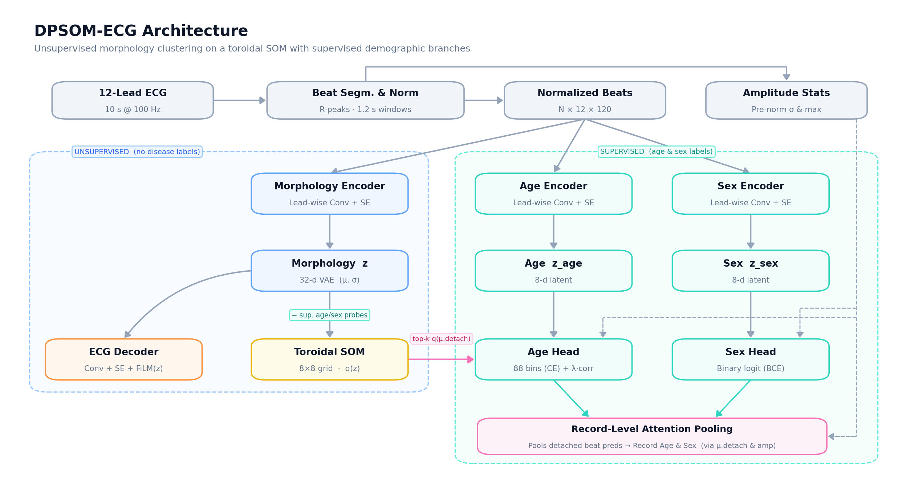

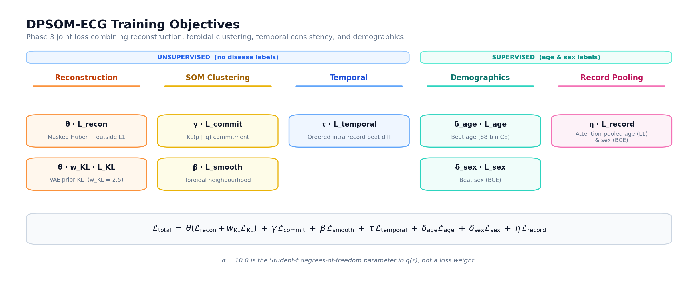

> The architecture and loss figures above are generated by `src/utils/make_figures.py`.

For a full implementation-level writeup (exact tensor shapes, formulas, training
phases, config defaults) see [`docs/architecture.md`](docs/architecture.md).

## Quick start

```bash
# from repo root
python -m venv .venv && source .venv/bin/activate
pip install -r requirements.txt
pip install -r explorer/requirements.txt   # optional, for the web explorer

# train with default config (uses data/processed/ptbxl_100_T-12ms.pkl if present,
# otherwise imports from data/raw/ptbxl/)
python -m src.training.trainer

# or customize SOM size, epochs, seed, etc.
python -m src.training.trainer --som-dim 16 16 --epochs 40 --seed 42
```

## Explorer

An interactive SOM explorer is available as a FastAPI + D3 web app (auto-loads the best checkpoint on startup, scopes datasets to `data/`, and supports fast compact `.npz` loading + lazy cell inspection):

```bash
# optional one-time export from 3.6 GB pickle -> compact per-split .npz (~60 MB for test)
python explorer/export_compact_data.py

# run locally
python explorer/server.py [--port 8050] [--host 0.0.0.0]

# or via Docker Compose
docker compose -f explorer/docker-compose.yml up --build -d
```

**Vercel static hosting** (zero Python serverless limits; all Vercel files live inside `explorer/` via [`explorer/vercel.json`](explorer/vercel.json)):

```bash
# Build full static snapshot (precomputed SOM grids, lazy cell files, Cell Compare stats,
# UDA Playground demos, 168-run benchmarks, and all 12 figures) and deploy from explorer/
python explorer/build_static_site.py
cd explorer && npx vercel --prod
```

- When linking the GitHub repository to Vercel, set **Root Directory** to `explorer`: `explorer/vercel.json` runs `python3 build_static_site.py --if-missing`, falling back gracefully to pure Python stdlib when checkpoints/`data/` are absent (System Overview, figures, and UDA benchmarks active; SOM grid shows a preview notice).
- **Vercel Web Analytics** is pre-wired in [`explorer/static/index.html`](explorer/static/index.html) via `/_vercel/insights/script.js` (`window.va`); enable the **Analytics** tab in your Vercel project dashboard to activate tracking.
- To pair a Vercel-hosted static frontend with live PyTorch ECG upload and arbitrary UDA runs on a GPU/CPU host, start `explorer/server.py` with `EXPLORER_CORS_ORIGINS=https://your-app.vercel.app` and open `https://your-app.vercel.app/?api=https://your-fastapi-host`.

Open `http://localhost:8050` in a browser to browse SOM nodes, inspect 12-lead ECG prototypes and percentile bands, and predict Age / Sex / SOM placement on new ECG files directly from the sidebar.

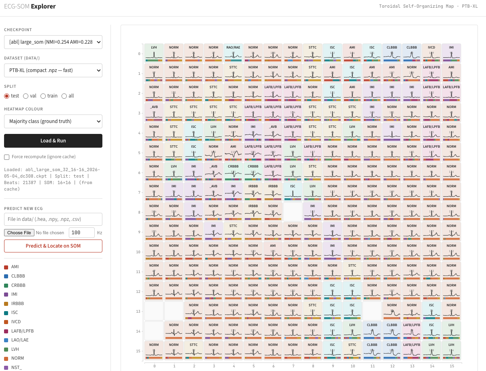

## Predicting on new ECG data

Use [`src/inference.py`](src/inference.py) to convert and predict on any new 12-lead ECG (WFDB `.hea`/`.dat`, `.npy`, `.npz`, or `.csv` at any sampling rate — automatically resampled to 100 Hz):

```bash
# predict age, sex & SOM cluster using the best model automatically (or pass --ckpt)
python -m src.inference --input path/to/ecg.npy --fs 500

# or convert a directory of ECGs into an Explorer-compatible dataset pickle
python -m src.inference --convert-dir path/to/ecgs/ --output data/processed/custom_ecgs.pkl --fs 500
```

## Multi-seed benchmarks, matched-k evaluation & external transfer

All models are trained across 3 fixed seeds (`42, 123, 456`) on curated PTB-XL (`train` = 13,504 records, `val` = 1,714 records; **16 diagnostic subclasses**) and evaluated on **all beats per record (`max_beats=None`)** on PTB-XL `test` (2,156 records, 21,387 beats) and two external zero-shot cohorts imported via [`src/data/cinc.py`](src/data/cinc.py):
- **Georgia 12-Lead ECG** (PhysioNet CinC 2020 `g1` subset — 461 records, 5,065 beats across 17 SNOMED-CT primary codes including 3 unmapped raw codes)
- **Chapman-Shaoxing 12-Lead ECG** (PhysioNet `ecg-arrhythmia` 1.0.0 — 377 quality-curated records, 4,058 beats across 9 clinical classes: `AFIB, AFL, NSR, PAC, SA, SB, STach, SVT, TInv`)

Evaluation protocol notes:
- **Validation checkpoint selection**: every method selects its best checkpoint on `val` (`val ELBO` for VAE, `val total loss` for 1D-ResNet, `val NMI` against diagnostic labels for DPSOM).
- **Record-level AMI (`Rec AMI`) as primary clustering metric**: beat-level NMI/Purity inflate strongly with cluster count `k` because all beats of a record share one record label (e.g., random per-record hashing already reaches beat-level NMI `0.483` on Georgia and `0.412` on Chapman-Shaoxing at `k = 256`). Record-level AMI (`Rec AMI`) removes both cluster-count and beat-duplication bias (`random_record` chance ≈ `0.000` at every `k`).
- All spreads report sample standard deviation (`ddof = 1`) over 3 seeds.

```bash
# 1. Download & import Georgia 12-Lead ECG and Chapman-Shaoxing (ecg-data-repo compatible)
python -m src.data.cinc --dataset georgia --max-records 500 --output data/processed/georgia_100.pkl
python -m src.data.cinc --dataset chapman_shaoxing --max-records 500 --output data/processed/chapman_shaoxing_100.pkl

# 2. Run 3-seed fair matched-k baselines, residualization ablations & zero-shot external eval
python ablation/run_paper_experiments.py \
  --seeds 42 123 456 --epochs 30 \
  --ext-data data/processed/georgia_100.pkl data/processed/chapman_shaoxing_100.pkl \
  --compute-disentanglement --output ablation/paper_results_all.json
```

All 21 runs (7 models × 3 seeds) plus empirical chance baselines are saved in [`ablation/paper_results_all.json`](ablation/paper_results_all.json) and [`ablation/paper_results_all.csv`](ablation/paper_results_all.csv).

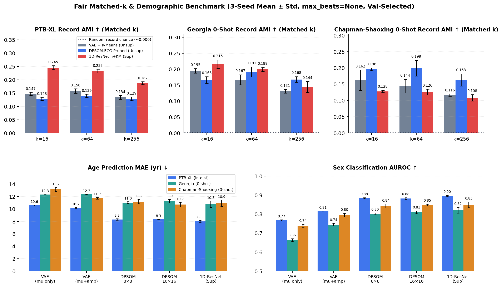

### Matched-k clustering: PTB-XL, zero-shot Georgia & zero-shot Chapman-Shaoxing (mean ± std, `ddof=1`, `max_beats=None`)

| Clusters `k` | Model | PTB-XL `Rec AMI` ↑ | PTB-XL `Beat NMI` ↑ | Georgia `Rec AMI` ↑ | Georgia `Beat NMI` ↑ | Chapman `Rec AMI` ↑ | Chapman `Beat NMI` ↑ |
|---:|---|---:|---:|---:|---:|---:|---:|
| `16` | *Chance (`random_record` / `rec_hash`)* | `−0.0009` | `0.0276` | `+0.0013` | `0.1154` | `+0.0011` | `0.1014` |
| `16` | **VAE + K-Means** (Unsup) | `0.1467 ± 0.0058` | `0.1491` | `0.1946 ± 0.0072` | `0.2121` | `0.1622 ± 0.0311` | `0.1806` |
| `16` | **DPSOM-ECG 4×4** (Pruned, Unsup SOM) | `0.1282 ± 0.0055` | `0.1414 ± 0.0041` | `0.1660 ± 0.0105` | `0.2150 ± 0.0127` | **`0.1957 ± 0.0040`** | **`0.2258 ± 0.0036`** |
| `16` | **1D-ResNet `h` + K-Means** (Sup repr.) | `0.2452 ± 0.0074` | `0.2283` | `0.2161 ± 0.0131` | `0.2479` | `0.1275 ± 0.0032` | `0.1762` |
| `16` | **1D-ResNet 16-cls head** (Sup upper bound) | `0.3438 ± 0.0013` | `0.3163 ± 0.0018` | `0.2124 ± 0.0143` | `0.2395 ± 0.0136` | `0.1196 ± 0.0260` | `0.1506 ± 0.0112` |
| `64` | *Chance (`random_record` / `rec_hash`)* | `+0.0006` | `0.0821` | `−0.0013` | `0.2821` | `+0.0015` | `0.2405` |
| `64` | **VAE + K-Means** (Unsup) | `0.1576 ± 0.0086` | `0.1734 ± 0.0028` | `0.1667 ± 0.0158` | `0.2920 ± 0.0053` | `0.1438 ± 0.0208` | `0.2283 ± 0.0065` |
| `64` | **DPSOM-ECG 8×8 (no res.)** (Unsup SOM) | **`0.1609 ± 0.0054`** | **`0.1948 ± 0.0077`** | `0.1680 ± 0.0077` | `0.3154 ± 0.0069` | `0.1822 ± 0.0068` | `0.2721 ± 0.0064` |
| `64` | **DPSOM-ECG 8×8** (Pruned default, Unsup SOM) | `0.1392 ± 0.0062` | `0.1759 ± 0.0064` | **`0.1914 ± 0.0157`** | `0.3237 ± 0.0095` | **`0.1989 ± 0.0240`** | **`0.2882 ± 0.0124`** |
| `64` | **1D-ResNet `h` + K-Means** (Sup repr.) | `0.2325 ± 0.0068` | `0.2512` | `0.1992 ± 0.0062` | `0.3190` | `0.1258 ± 0.0087` | `0.2178` |
| `256` | *Chance (`random_record` / `rec_hash`)* | `+0.0009` | `0.2042` | `+0.0056` | `0.4829` | `+0.0012` | `0.4117` |
| `256` | **VAE + K-Means** (Unsup) | `0.1338 ± 0.0072` | `0.2121` | `0.1310 ± 0.0058` | `0.3762` | `0.1165 ± 0.0032` | `0.2928` |
| `256` | **DPSOM-ECG 16×16** (Pruned, Unsup SOM) | `0.1286 ± 0.0072` | `0.2039 ± 0.0040` | **`0.1677 ± 0.0089`** | `0.3792 ± 0.0062` | **`0.1627 ± 0.0185`** | **`0.3164 ± 0.0116`** |
| `256` | **1D-ResNet `h` + K-Means** (Sup repr.) | `0.1874 ± 0.0054` | `0.2782` | `0.1444 ± 0.0172` | `0.3839` | `0.1081 ± 0.0097` | `0.2790` |

### Demographic prediction: PTB-XL, Georgia & Chapman-Shaoxing (mean ± std, `ddof=1`)

| Model | Demographic head / probe | PTB-XL MAE Age ↓ | PTB-XL AUC Sex ↑ | Georgia MAE ↓ | Georgia AUC ↑ | Chapman MAE ↓ | Chapman AUC ↑ |
|---|---|---:|---:|---:|---:|---:|---:|
| **VAE (`mu` only)** | Linear probe on record-mean `mu` | `10.56 ± 0.10` | `0.7676 ± 0.0031` | `12.33 ± 0.07` | `0.6630 ± 0.0078` | `13.15 ± 0.33` | `0.7380 ± 0.0089` |
| **VAE (`mu + amp`)** | Linear probe on `[mu, amp_context]` | `10.18 ± 0.06` | `0.8144 ± 0.0022` | `12.35 ± 0.05` | `0.7446 ± 0.0073` | `11.71 ± 0.13` | `0.7955 ± 0.0097` |
| **DPSOM-ECG 4×4** | Dedicated `z_age`/`z_sex` + `amp_context` | `8.44 ± 0.10` | `0.8853 ± 0.0013` | `11.22 ± 0.22` | `0.8023 ± 0.0047` | `11.13 ± 0.18` | **`0.8501 ± 0.0065`** |
| **DPSOM-ECG 8×8** | Dedicated `z_age`/`z_sex` + `amp_context` | `8.31 ± 0.13` | `0.8844 ± 0.0027` | `11.03 ± 0.16` | `0.8018 ± 0.0050` | `11.19 ± 0.35` | `0.8437 ± 0.0101` |
| **DPSOM-ECG 16×16** | Dedicated `z_age`/`z_sex` + `amp_context` | `8.33 ± 0.03` | `0.8830 ± 0.0042` | `11.27 ± 0.30` | `0.8098 ± 0.0074` | **`10.72 ± 0.37`** | `0.8482 ± 0.0050` |
| **1D-ResNet** (Supervised) | Supervised multi-task heads + `amp_context` | **`8.02 ± 0.15`** | **`0.8961 ± 0.0033`** | **`10.77 ± 0.52`** | **`0.8209 ± 0.0149`** | `10.93 ± 0.51` | `0.8494 ± 0.0153` |

### Residualization & pruned vs. legacy defaults (8×8 SOM, 3 seeds, `ddof=1`)

Unconfounded demographic leakage is measured by fitting record-grouped linear probes (`Ridge` Age `R²`, `LogisticRegression` Sex `AUROC`) on deterministic latent means `mu` (raw) vs. `residualize_latent(mu)` (`res`) across all 3 seeds:

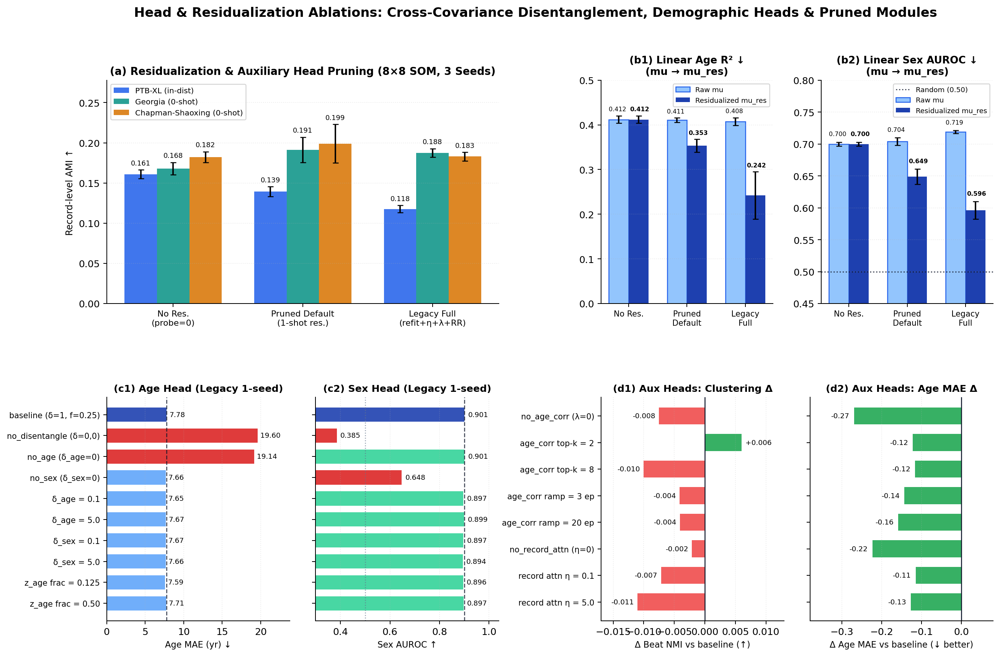

| Variant (`8×8` SOM) | PTB-XL `Rec AMI` ↑ | Georgia `Rec AMI` ↑ | Chapman `Rec AMI` ↑ | Linear Age `R²` (`mu → mu_res`) ↓ | Linear Sex `AUROC` (`mu → mu_res`) ↓ | PTB-XL MAE ↓ |
|---|---:|---:|---:|---:|---:|---:|
| `dpsom_pruned_8x8_no_res` (`num_epochs_probe=0`) | `0.1609 ± 0.0054` | `0.1680 ± 0.0077` | `0.1822 ± 0.0068` | `0.412 → 0.412 ± 0.008` | `0.700 → 0.700 ± 0.003` | `8.35 ± 0.08` |
| `dpsom_pruned_8x8` (Default: `probe_refit_interval=0`) | `0.1392 ± 0.0062` | `0.1914 ± 0.0157` | `0.1989 ± 0.0240` | `0.411 → 0.353 ± 0.015` | `0.704 → 0.649 ± 0.012` | `8.31 ± 0.13` |
| `dpsom_legacy_full_8x8` (`probe_refit_interval=6`, `eta=1`, `λ=0.3`, `RR=True`) | `0.1177 ± 0.0044` | `0.1875 ± 0.0053` | `0.1829 ± 0.0054` | `0.408 → 0.242 ± 0.053` | `0.719 → 0.596 ± 0.014` | `8.37 ± 0.04` |

Key findings:
- **Fair matched-`k` clustering**: On PTB-XL record-level AMI, `DPSOM 8×8 (no res.)` (`0.1609`) slightly exceeds `VAE + K-Means` (`0.1576`), while supervised `1D-ResNet` (`0.2325` via `h`+K-Means; `0.3438` via 16-class head) remains the upper bound. Under domain & label-taxonomy shift, **DPSOM-ECG consistently outperforms `VAE + K-Means` at matched `k ≥ 64` on Georgia** (`0.1914` vs `0.1667` at `k = 64`; `0.1677` vs `0.1310` at `k = 256`) and **beats both `VAE + K-Means` and supervised `1D-ResNet h+K-Means` across all `k ∈ {16, 64, 256}` on Chapman-Shaoxing** (`0.1957 / 0.1989 / 0.1627` vs VAE `0.1622 / 0.1438 / 0.1165` and 1D-ResNet `0.1275 / 0.1258 / 0.1081`).
- **Demographic prediction**: Dedicated `z_age`/`z_sex` encoders outperform linear probes on VAE embeddings even when the VAE probes also receive `amp_context` (`8.31` vs `10.18` yr MAE, `0.884` vs `0.814` AUC on PTB-XL), matching or slightly exceeding supervised `1D-ResNet` under shift on Chapman-Shaoxing (`10.72` vs `10.93` yr MAE for 16×16; `0.8501` vs `0.8494` AUC for 4×4).
- **Disentanglement trade-off**: Closed-form cross-covariance residualization zeroes linear age `R²` (`~0.000`) immediately after fitting, but Phase 3 encoder updates gradually re-introduce age/sex variance (`0.411 → 0.353` with `probe_refit_interval=0`). Periodic closed-form refitting (`probe_refit_interval=6`) lowers leakage further (`0.408 → 0.242` Age `R²`, `0.719 → 0.596` Sex `AUROC`) at a PTB-XL `Rec AMI` cost (`0.1392 → 0.1177`) since PTB-XL diagnoses correlate strongly with age. Removing demographic directions improves zero-shot `Rec AMI` on **both** external cohorts (Georgia `0.1680 → 0.1914`; Chapman-Shaoxing `0.1822 → 0.1989`).
- **Pruned defaults (`src/config.py`)**: `age_corr_lambda_max = 0.0`, `eta = 0.0`, `probe_refit_interval = 0`, and `use_rr_features = False` are disabled by default (simplifying the model with no measurable accuracy loss over `dpsom_legacy_full_8x8`) while remaining toggleable via CLI flags (`--with-age-corr`, `--with-record-attn`, `--with-rr`, `--probe-refit-interval 6`).

### Cross-dataset transfer ablation (Source → Target, 3 seeds, `ddof=1`)

To evaluate whether a trained DPSOM-ECG model transfers bidirectionally across cohorts with different geographies, acquisition sites, and label taxonomies, we built stratified 10-fold transfer cohorts for **Georgia** (`2,412` quality-curated records, 20 classes: `train=1,930`, `val=241`, `test=241`) and **Chapman-Shaoxing** (`2,330` quality-curated records, 14 classes: `train=1,864`, `val=233`, `test=233`), alongside curated **PTB-XL Full** (`train=13,504`, `test=2,156`, 16 classes) and a size-matched **`PTB-XL 2k`** control (`train=1,800`, `val=225`, `test=2,156`).

```bash
# 1. Build stratified 10-fold transfer cohorts
python -m src.data.cinc --dataset georgia --download-dir data/raw/georgia_transfer --max-records 2500 --min-class-count 15 --stratified-folds --output data/processed/georgia_transfer_100.pkl
python -m src.data.cinc --dataset chapman_shaoxing --download-dir data/raw/chapman_transfer --max-records 2500 --min-class-count 15 --stratified-folds --output data/processed/chapman_transfer_100.pkl

# 2. Run 3-seed cross-dataset transfer + unlabeled SOM adaptation (+UDA)
CUDA_VISIBLE_DEVICES=0 python ablation/run_cross_dataset_ablation.py --sources ptbxl_full georgia --seeds 42 123 456 --output ablation/xds_gpu0.json
CUDA_VISIBLE_DEVICES=1 python ablation/run_cross_dataset_ablation.py --sources ptbxl_2k chapman --seeds 42 123 456 --output ablation/xds_gpu1.json
python ablation/run_cross_dataset_ablation.py --merge ablation/xds_gpu0.json ablation/xds_gpu1.json --output ablation/cross_dataset_results.json --plot ablation/cross_dataset_transfer.png
```

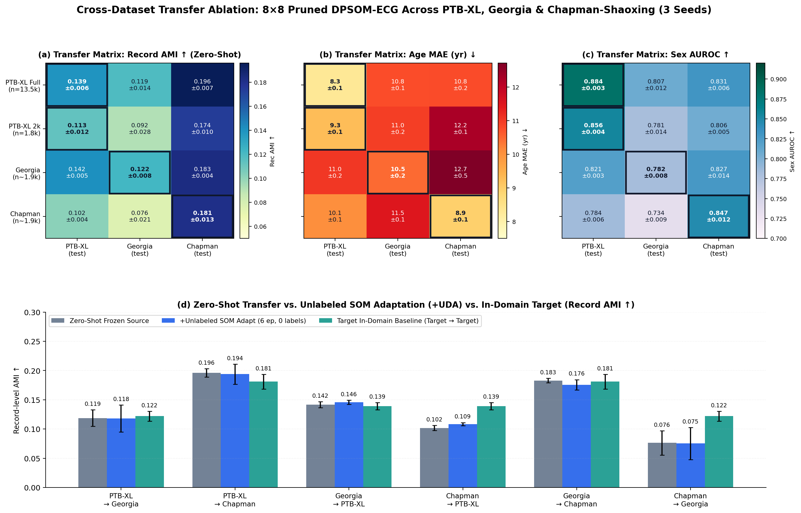

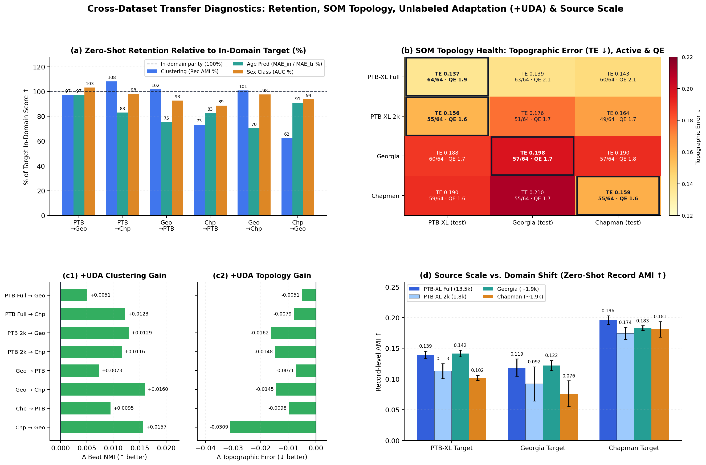

| Source (train records) | → PTB-XL `Rec AMI` / `MAE` / `AUC` | → Georgia `Rec AMI` / `MAE` / `AUC` | → Chapman `Rec AMI` / `MAE` / `AUC` |
|---|---:|---:|---:|
| **PTB-XL Full** (`13,504`) | **`0.1392`** / **`8.31`** / **`0.884`** | `0.1186` / `10.76` / **`0.807`** | **`0.1960`** / `10.78` / `0.831` |
| **PTB-XL 2k** (`1,800`) | `0.1128` / `9.26` / `0.856` | `0.0922` / `10.95` / `0.781` | `0.1743` / `12.24` / `0.806` |
| **Georgia** (`1,930`) | **`0.1417`** *(+UDA `0.1458`)* / `11.02` / `0.821` | **`0.1220`** / **`10.47`** / `0.782` | `0.1829` / `12.71` / `0.827` |
| **Chapman** (`1,864`) | `0.1018` *(+UDA `0.1085`)* / `10.05` / `0.784` | `0.0762` / `11.49` / `0.734` | `0.1811` / **`8.95`** / **`0.847`** |

Key transfer findings (`cross_dataset_results.json`, empirical `random_record` AMI chance $\le 0.002$ on all 3 targets):
- **Strong zero-shot bidirectional clustering & size symmetry**: Models trained on Georgia transfer zero-shot to PTB-XL test (`0.1417` Rec AMI) at least as well as PTB-XL Full (`0.1392`) and clearly above size-matched `PTB-XL 2k` (`0.1128`), and also transfer strongly to Chapman (`0.1829`). On Chapman, `PTB-XL Full → Chapman` (`0.1960`) slightly exceeds in-domain `Chapman → Chapman` (`0.1811`), reflecting the benefit of 7× more diverse morphology pretraining.
- **Population & domain-shift asymmetry**: **Chapman-Shaoxing shows the narrowest coverage when used as the source** (`Chapman → Georgia` = `0.0762`, `Chapman → PTB-XL` = `0.1018` vs `PTB-XL 2k → Georgia` = `0.0922`), matching its rhythm-skewed class mix (`SB`, `NSR`, `AFL`, and `STach` account for `82.1%` of `chapman_transfer_100.pkl` vs broader structural pathology coverage in PTB-XL/Georgia). Larger source diversity (`PTB-XL Full` vs `PTB-XL 2k`) adds `+0.022` to `+0.026` Rec AMI across every target.
- **Unlabeled SOM adaptation (`+UDA`, 6 epochs, zero labels)**: Freezing demographic heads and fine-tuning only morphology/SOM weights on unlabeled target records consistently preserves codebook utilization (`50.7–62.7/64` active nodes) and improves clustering when moving from narrower/equal cohorts onto broader ones (`Georgia → PTB-XL`: `0.1417 → 0.1458`, Beat NMI `0.1689 → 0.1762`; `Chapman → PTB-XL`: `0.1018 → 0.1085`; `PTB-XL 2k → Chapman`: `0.1743 → 0.1837`), while leaving demographic predictions untouched.
- **Demographic transfer**: Age MAE rises smoothly by `+1.8–2.5` yr (`~8.3–10.5` in-domain → `10.1–12.7` zero-shot) and Sex AUROC retains strong cross-continental discriminability (`0.78–0.83` between Europe/USA/China; lower only on `Chapman → Georgia` at `0.734`).

#### Targeted UDA & Demographic Adaptation Ablation (3 Seeds, 8 Off-Diagonal Pairs)

```bash
CUDA_VISIBLE_DEVICES=0 python ablation/run_uda_ablation.py --sources ptbxl_full georgia --seeds 42 123 456 --output ablation/uda_gpu0.json
CUDA_VISIBLE_DEVICES=1 python ablation/run_uda_ablation.py --sources ptbxl_2k chapman --seeds 42 123 456 --output ablation/uda_gpu1.json
python ablation/run_uda_ablation.py --merge ablation/uda_gpu0.json ablation/uda_gpu1.json --output ablation/uda_ablation_results.json --plot ablation/uda_ablation.png
```

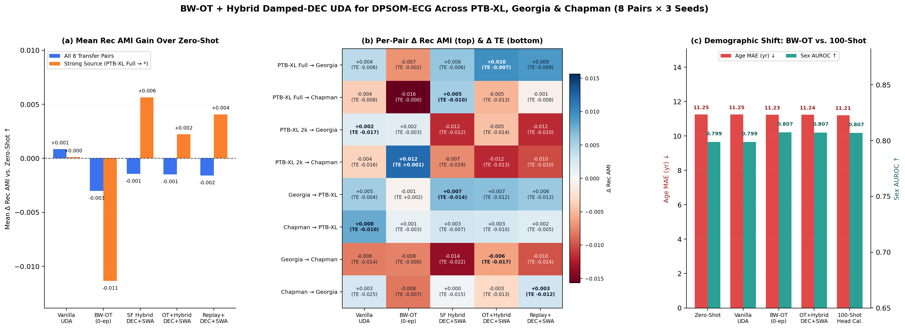

| Adaptation Regime | Target Labels | Mean `Rec AMI` ↑ (8 pairs) | `PTB-XL Full → Geo / Chp` `Rec AMI` ↑ | `TE` ↓ | `QE` ↓ | `Age MAE` ↓ | `Sex AUROC` ↑ |
|---|---:|---:|---:|---:|---:|---:|---:|
| **`zero_shot`** | `0` | `0.1363` | `0.1186` / `0.1960` | `0.165` | `1.80` | `11.25` | `0.7988` |
| **`uda_vanilla`** (beat DEC + SOM) | `0` | **`0.1372`** | `0.1227` / `0.1922` | **`0.152`** | `1.76` | `11.25` | `0.7988` |
| **`uda_bw_ot`** (closed-form BW-OT, 0.1 s) | `0` | `0.1333` | `0.1115` / `0.1804` | `0.163` | `1.80` | `11.23` | **`0.8074`** |
| **`uda_sf_strong`** (Hybrid DEC + SWA) | `0` | `0.1349` | `0.1246` / **`0.2013`** | **`0.152`** | **`1.75`** | `11.25` | `0.7988` |
| **`uda_ot_strong`** (BW-OT Demo + Hybrid DEC + SWA) | `0` | `0.1348` | **`0.1282`** / `0.1909` | **`0.152`** | **`1.75`** | `11.24` | **`0.8073`** |
| **`uda_replay_strong`** (BW-OT + Replay + Hybrid DEC + SWA) | `0` | `0.1347` | `0.1275` / `0.1952` | `0.155` | **`1.75`** | `11.23` | **`0.8073`** |
| **`fewshot_100_head`** (BW-OT + 100-shot demo heads) | `100` | `0.1363` | `0.1186` / `0.1960` | `0.165` | `1.80` | **`11.21`** | `0.8069` |

Key findings ([`src/training/uda.py`](src/training/uda.py), [`ablation/uda_ablation_results.json`](ablation/uda_ablation_results.json)):
- **Closed-form Bures-Wasserstein Optimal Transport (`uda_bw_ot`, 0 labels, ~0.1 s)** folded directly into linear heads raises `Sex AUROC` on **8/8** transfer pairs (`0.7988 → 0.8074` mean; e.g. `Georgia → Chapman` `0.8274 → 0.8421`, `Chapman → Georgia` `0.7341 → 0.7475`, `PTB-XL Full → Georgia` `0.8072 → 0.8196`), matching/slightly outperforming 100-shot labeled head fine-tuning (`0.8069`) with zero backprop or node collapse.
- **Strong-source morphology transfer gains from Hybrid Beat+Record Damped-DEC + SWA**: On `PTB-XL Full → Georgia`, `uda_ot_strong` lifts `Rec AMI` from `0.1186` (`zero_shot`) / `0.1227` (`uda_vanilla`) to **`0.1282`** while improving Sex AUROC (`0.8072 → 0.8195`) and lowering `TE` (`0.139 → 0.132`); on `PTB-XL Full → Chapman`, `uda_sf_strong` improves `Rec AMI` (`0.1960 → 0.2013`, tighter std `0.0108` vs `0.0161` vanilla).
- **Mean clustering trade-off on weaker sources**: Damped equalization (`ρ = 0.75`) preserves topology (`TE = 0.152`, lowest `QE = 1.75` vs `1.80` zero-shot), while full `ρ = 1.0` beat-level DEC (`uda_vanilla`) still edges ahead on overall 8-pair mean `Rec AMI` (`0.1372`) when adapting narrower sources (`ptbxl_2k`, `chapman`) where aggressive equalization helps rebalance sparse nodes.

### Single-seed DPSOM parameter sensitivity sweep (`seed=42`, 24 epochs)

> **Caveat**: This 29-variant 1-D sweep uses a single seed (`seed=42`, 24 epochs) and beat-level NMI for directional exploration; small differences (`< 0.015` on Georgia) fall within multi-seed variance. Use the 3-seed matched-`k` record-level tables above for formal model comparisons.

```bash
CUDA_VISIBLE_DEVICES=0 python ablation/run_dpsom_sensitivity.py --shard 0/2 --output ablation/sens_gpu0.json
CUDA_VISIBLE_DEVICES=1 python ablation/run_dpsom_sensitivity.py --shard 1/2 --output ablation/sens_gpu1.json
python ablation/run_dpsom_sensitivity.py --merge ablation/sens_gpu0.json ablation/sens_gpu1.json \
  --output ablation/dpsom_sensitivity_results.json --plot ablation/dpsom_sensitivity.png \
  --plot-baselines ablation/baseline_comparison.png
```

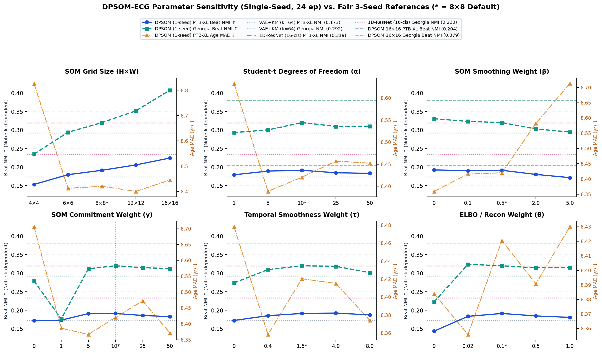

| Parameter | Sweep range (`*` = default) | PTB-XL Beat NMI ↑ | Georgia Beat NMI ↑ | Directional topology & stability finding |
|---|---|---:|---:|---|
| **SOM grid `H×W`** | `4×4, 6×6, 8×8*, 12×12, 16×16` | `0.153 → 0.191 → 0.224` | `0.235 → 0.407` | Beat NMI rises with `k` largely due to cluster-count bias (see matched-`k` `Rec AMI` above, which peaks at `8×8`). Active units: `100% → 87.9%`. |
| **Student-t df `α`** | `1, 5, 10*, 25, 50` | `0.179 → 0.191 → 0.183` | `0.293 → 0.320 → 0.310` | Very heavy tails (`α = 1`) raise topographic error (`TE = 0.226` vs `0.134` at `α = 10`); `α ∈ [5, 10]` performs similarly. |
| **SOM smoothing `β`** | `0, 0.1, 0.5*, 2.0, 5.0` | `0.192 → 0.191 → 0.172` | `0.330 → 0.320 → 0.295` | Topology–clustering trade-off: `β = 0` increases topographic error (`TE = 0.235` vs `0.134` at `β = 0.5`, `0.077` at `β = 2.0`); heavy smoothing (`β = 5`) degrades NMI. |
| **SOM commit `γ`** | `0, 1, 5, 10*, 25, 50` | `0.172 → 0.191 → 0.183` | `0.279 / 0.177 → 0.320` | Strong effect: `γ = 0` worsens NMI and TE (`0.200`); weak `γ = 1` collapses codebook (`15/64` active nodes); healthy utilization for `γ ≥ 5`. |
| **Temporal `τ`** | `0, 0.4, 1.6*, 4.0, 8.0` | `0.172 → 0.191 → 0.187` | `0.274 → 0.320 → 0.301` | Removing `τ` worsens `QE` (`2.205` vs `1.787`) and lowers PTB-XL Beat NMI (`−0.019`); stable across `[1.6, 4.0]`. |
| **ELBO/recon `θ`** | `0, 0.02, 0.1*, 0.5, 1.0` | `0.144 → 0.191 → 0.181` | `0.222 → 0.320 → 0.316` | Strong effect: removing `θ` in Phase 3 collapses active nodes (`36/64`) and drops PTB-XL NMI (`−0.048`). |
| **Latent dim `d`** | `16, 32*, 64` | `0.188 / 0.191 / 0.188` | `0.331 / 0.320 / 0.321` | Insensitive across `[16, 64]`; `d = 32` is a balanced default. |

Full per-run metrics (including `AMI`, `Purity`, `Active_Nodes`, `Occ_Entropy`, `QE`, `TE`, `Nbr_Consistency`) are saved in [`ablation/dpsom_sensitivity_results.csv`](ablation/dpsom_sensitivity_results.csv).

## Legacy single-seed ablation study (pre-curation / unpruned defaults)

> **Legacy note**: The 48-variant sweep below (`ablation/ablation_results_all.csv`) was recorded on an earlier unpruned configuration (`eta = 1.0`, `age_corr_lambda_max = 0.30`, pre-`ecg-data-repo` curation, 8 beats/record at test) and is **not directly comparable** to the curated 3-seed `max_beats=None` benchmarks above. It is preserved for historical hyperparameter reference.

```bash
# run all ablation variants in parallel across 2 GPUs
bash ablation/run_ablation_parallel.sh

# or run specific variants
python ablation/ablation.py --variants baseline no_temporal no_disentangle
```

Results are written to `ablation/ablation_results*.csv/json` and merged into `ablation_results_all.csv`.
The notebook `ablation/ablation_exploration.ipynb` visualises all results interactively.

### Results summary

All 48 ablation variants completed successfully on PTB-XL test split.

| Metric | Meaning | Direction |
|--------|---------|-----------|
| NMI | Normalised Mutual Information (cluster ↔ disease label) | ↑ better |
| AMI | Adjusted Mutual Information | ↑ better |
| Purity | Majority-class fraction per SOM node | ↑ better |
| MAE Age | Mean absolute error for age regression (years) | ↓ better |
| AUC Sex | AUROC for sex classification | ↑ better |

**Baseline (8×8 SOM):** NMI = 0.208 · AMI = 0.200 · Purity = 0.538 · MAE Age = 7.78 · AUC Sex = 0.901

### Loss-term ablations

Removing individual loss components from the full model.

| Variant | Removed / changed | NMI | AMI | Purity | MAE Age | AUC Sex |
|---|---|---|---|---|---|---|
| **baseline** | — | **0.208** | **0.200** | **0.538** | 7.78 | **0.901** |
| no_kl | γ = 0 (no SOM commitment KL(p ‖ q)) | 0.000 | 0.000 | 0.449 | 7.71 | 0.896 |
| no_som_smooth | α = 0 (Student-t df clamped to 1e-4) | 0.141 | 0.133 | 0.492 | 7.69 | 0.894 |
| no_temporal | τ = 0 (no temporal beat-sequence loss) | 0.178 | 0.169 | 0.526 | 7.73 | 0.898 |
| no_som_commit | β = 0 (no SOM neighbourhood smoothing) | 0.205 | 0.197 | 0.529 | 7.65 | 0.899 |
| no_record_attn | η = 0 (no record-level attention pooling) | 0.206 | 0.198 | 0.544 | 7.56 | 0.898 |
| no_disentangle | δ_age = δ_sex = 0 (demographic supervision off; probes still run) | 0.198 | 0.189 | 0.534 | 19.60 | 0.385 |
| no_age | δ_age = 0 (age supervision off) | 0.202 | 0.194 | 0.535 | 19.14 | 0.901 |
| no_sex | δ_sex = 0 (sex supervision off) | 0.213 | 0.205 | 0.546 | 7.66 | 0.648 |
| no_age_corr | λ_max = 0 (age-correction module off) | 0.200 | 0.192 | 0.538 | 7.51 | 0.902 |

Key findings:
- **SOM commitment loss (`γ · KL(p ‖ q)`) is essential** — removing it (`no_kl`, `γ = 0`) collapses NMI to 0.
- **Demographic supervision drives the age/sex branches** — setting `δ_age = δ_sex = 0` (`no_disentangle`) leaves the demographic heads untrained (raising MAE Age from 7.8 to 19.6 years and dropping sex AUC to 0.385), while SOM residualization probes continue to run independently.
- **Temporal smoothing matters most among auxiliary losses** — `no_temporal` (`τ = 0`) drops NMI by −0.030.
- **Student-t degrees of freedom (`α`) strongly affect clustering** — clamping `α → 1e-4` (`no_som_smooth`) drops NMI by −0.067.

### Architecture ablations

#### SOM size

| Variant | Grid | NMI | AMI | Purity | MAE Age | AUC Sex |
|---|---|---|---|---|---|---|
| small_som | 4×4 | 0.129 | 0.126 | 0.480 | 7.67 | **0.905** |
| **baseline** | **8×8** | **0.208** | **0.200** | **0.538** | 7.78 | 0.901 |
| large_som | 16×16 | **0.254** | **0.228** | **0.575** | **7.61** | 0.896 |

A 16×16 SOM improves NMI by +0.046 and purity by +0.037. A 4×4 grid is significantly worse, showing the model needs sufficient resolution to separate disease sub-types.

#### Latent dimensionality

| Variant | z_dim | NMI | AMI | Purity | MAE Age | AUC Sex |
|---|---|---|---|---|---|---|
| small_latent | 16 | 0.196 | 0.188 | 0.537 | **7.52** | 0.902 |
| **baseline** | **32** | **0.208** | **0.200** | **0.538** | 7.78 | **0.901** |
| large_latent | 64 | 0.204 | 0.195 | 0.538 | 7.62 | 0.898 |

The model is not very sensitive to latent dimensionality; 32 dimensions is a good default.

#### Encoder width

| Variant | channels | NMI | AMI | Purity | MAE Age | AUC Sex |
|---|---|---|---|---|---|---|
| narrow_encoder | 16 / 32 | 0.195 | 0.187 | 0.536 | 7.88 | 0.898 |
| **baseline** | **32 / 64** | **0.208** | **0.200** | **0.538** | 7.78 | 0.901 |
| wide_encoder | 64 / 128 | 0.205 | 0.197 | 0.532 | **7.55** | **0.902** |

#### FC hidden dimension

| Variant | fc_dim | NMI | AMI | Purity | MAE Age | AUC Sex |
|---|---|---|---|---|---|---|
| small_fc | 256 | 0.200 | 0.191 | 0.530 | 7.63 | 0.895 |
| **baseline** | **512** | **0.208** | **0.200** | **0.538** | 7.78 | **0.901** |
| large_fc | 1024 | 0.210 | 0.202 | 0.539 | 7.64 | 0.899 |

#### Convolutional kernel size

| Variant | kernel | NMI | AMI | Purity | MAE Age | AUC Sex |
|---|---|---|---|---|---|---|
| small_kernel | 3 | 0.203 | 0.194 | **0.540** | 7.73 | 0.903 |
| **baseline** | **7** | **0.208** | **0.200** | 0.538 | 7.78 | 0.901 |
| large_kernel | 11 | 0.190 | 0.181 | 0.530 | **7.54** | **0.904** |

#### Age latent fraction

| Variant | z_age / z (fraction) | NMI | AMI | Purity | MAE Age | AUC Sex |
|---|---|---|---|---|---|---|
| small_age_latent | 0.125 | 0.205 | 0.196 | **0.539** | 7.59 | 0.896 |
| **baseline** | **0.25** | **0.208** | **0.200** | 0.538 | 7.78 | **0.901** |
| large_age_latent | 0.5 | 0.202 | 0.194 | 0.535 | 7.71 | 0.897 |

### Age-correction module

| Variant | Description | NMI | AMI | Purity | MAE Age | AUC Sex |
|---|---|---|---|---|---|---|
| no_age_corr | λ_max = 0 (correction disabled) | 0.200 | 0.192 | 0.538 | **7.51** | 0.902 |
| less_topk | top-k = 2 | 0.214 | 0.206 | **0.546** | 7.66 | 0.902 |
| **baseline** | **top-k = 4, ramp = 10 ep** | **0.208** | **0.200** | 0.538 | 7.78 | 0.901 |
| more_topk | top-k = 8 | 0.198 | 0.190 | 0.531 | 7.66 | 0.900 |
| fast_ramp | ramp = 3 epochs | 0.204 | 0.196 | 0.544 | 7.64 | 0.899 |
| slow_ramp | ramp = 20 epochs | 0.204 | 0.196 | 0.537 | 7.62 | **0.904** |

Using fewer top-k nodes (2 instead of 4) slightly improves NMI and purity, suggesting a sparser correction is preferable.

### Hyperparameter sweeps

#### Loss weights

| Variant | Parameter | Value | NMI | AMI | Purity | MAE Age | AUC Sex |
|---|---|---|---|---|---|---|---|
| alpha_low | α (Student-t df in q(z)) | 1.0 ↓ | 0.140 | 0.132 | 0.491 | 7.58 | 0.896 |
| **baseline** | α | **10.0** | **0.208** | **0.200** | **0.538** | 7.78 | **0.901** |
| alpha_high | α | 50.0 ↑ | 0.193 | 0.184 | 0.525 | 7.64 | 0.894 |
| beta_low | β (SOM smoothing) | 0.05 ↓ | 0.212 | 0.204 | 0.539 | 7.70 | 0.902 |
| **baseline** | β | **0.5** | **0.208** | **0.200** | **0.538** | 7.78 | **0.901** |
| beta_high | β | 5.0 ↑ | 0.193 | 0.184 | 0.530 | 7.59 | 0.896 |
| gamma_low | γ (SOM commit KL(p ‖ q)) | 1.0 ↓ | 0.153 | 0.150 | 0.480 | 7.70 | 0.893 |
| **baseline** | γ | **10.0** | **0.208** | **0.200** | **0.538** | 7.78 | **0.901** |
| gamma_high | γ | 50.0 ↑ | 0.196 | 0.188 | 0.534 | 7.75 | 0.895 |
| tau_low | τ (temporal) | 0.2 ↓ | 0.188 | 0.179 | 0.524 | 7.57 | 0.896 |
| **baseline** | τ | **1.6** | **0.208** | **0.200** | **0.538** | 7.78 | **0.901** |
| tau_high | τ | 8.0 ↑ | 0.204 | 0.195 | 0.537 | 7.64 | 0.894 |
| theta_low | θ (ELBO / recon) | 0.01 ↓ | 0.199 | 0.191 | 0.533 | 7.60 | **0.905** |
| **baseline** | θ | **0.1** | **0.208** | **0.200** | **0.538** | 7.78 | 0.901 |
| theta_high | θ | 1.0 ↑ | 0.189 | 0.181 | 0.523 | 7.69 | 0.902 |
| eta_low | η (record attn) | 0.1 ↓ | 0.201 | 0.192 | 0.535 | 7.67 | 0.901 |
| **baseline** | η | **1.0** | **0.208** | **0.200** | **0.538** | 7.78 | **0.901** |
| eta_high | η | 5.0 ↑ | 0.197 | 0.189 | 0.533 | 7.65 | 0.896 |

The model is most sensitive to α (Student-t degrees of freedom) and γ (SOM commitment KL weight) — both must be in the right order of magnitude.

#### Optimiser and regularisation

| Variant | Parameter | Value | NMI | AMI | Purity | MAE Age | AUC Sex |
|---|---|---|---|---|---|---|---|
| delta_age_low | δ_age | 0.1 ↓ | 0.205 | 0.197 | 0.536 | 7.65 | 0.897 |
| **baseline** | δ_age | **1.0** | **0.208** | **0.200** | **0.538** | 7.78 | **0.901** |
| delta_age_high | δ_age | 5.0 ↑ | 0.204 | 0.196 | 0.533 | 7.67 | 0.899 |
| delta_sex_low | δ_sex | 0.1 ↓ | 0.199 | 0.190 | 0.528 | 7.67 | 0.897 |
| **baseline** | δ_sex | **1.0** | **0.208** | **0.200** | **0.538** | 7.78 | **0.901** |
| delta_sex_high | δ_sex | 5.0 ↑ | 0.209 | 0.201 | 0.539 | 7.66 | 0.894 |
| lr_low | learning rate | 1e-4 ↓ | 0.199 | 0.191 | 0.537 | 8.23 | 0.895 |
| **baseline** | learning rate | **7e-4** | **0.208** | **0.200** | **0.538** | 7.78 | **0.901** |
| lr_high | learning rate | 3e-3 ↑ | 0.195 | 0.187 | 0.527 | 7.65 | 0.899 |
| wd_low | weight decay | 1e-5 | 0.207 | 0.198 | 0.538 | 7.72 | 0.903 |
| **baseline** | weight decay | **0.0** | **0.208** | **0.200** | **0.538** | 7.78 | 0.901 |
| wd_high | weight decay | 1e-3 ↑ | 0.207 | 0.199 | 0.534 | 7.89 | 0.903 |
| dropout_low | dropout | 0.0 ↓ | 0.191 | 0.183 | 0.525 | 8.04 | 0.888 |
| **baseline** | dropout | **0.2** | **0.208** | **0.200** | **0.538** | 7.78 | **0.901** |
| dropout_high | dropout | 0.5 ↑ | 0.203 | 0.195 | 0.534 | 7.62 | 0.901 |

Turning off dropout (dropout_low) notably hurts performance, confirming it is an important regulariser. The model is otherwise robust to learning rate and weight decay within a reasonable range.

### SOM, latent-space & reconstruction visualizations

Inspecting the trained 8×8 toroidal SOM ([`gpu_fast_seed42_best.ckpt`](models/gpu_fast_seed42/gpu_fast_seed42_best.ckpt) — **64/64 active nodes**, `QE = 1.90`, `TE = 0.168`, normalized occupancy entropy `0.955`) across in-distribution PTB-XL and both zero-shot external cohorts:

```bash
python -m src.utils.make_paper_figures
```

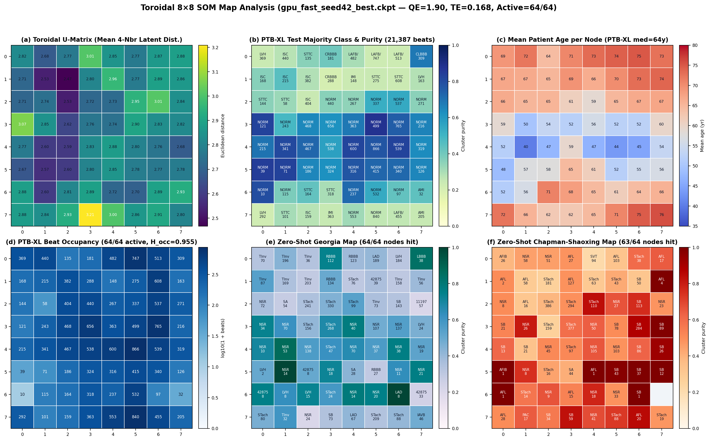

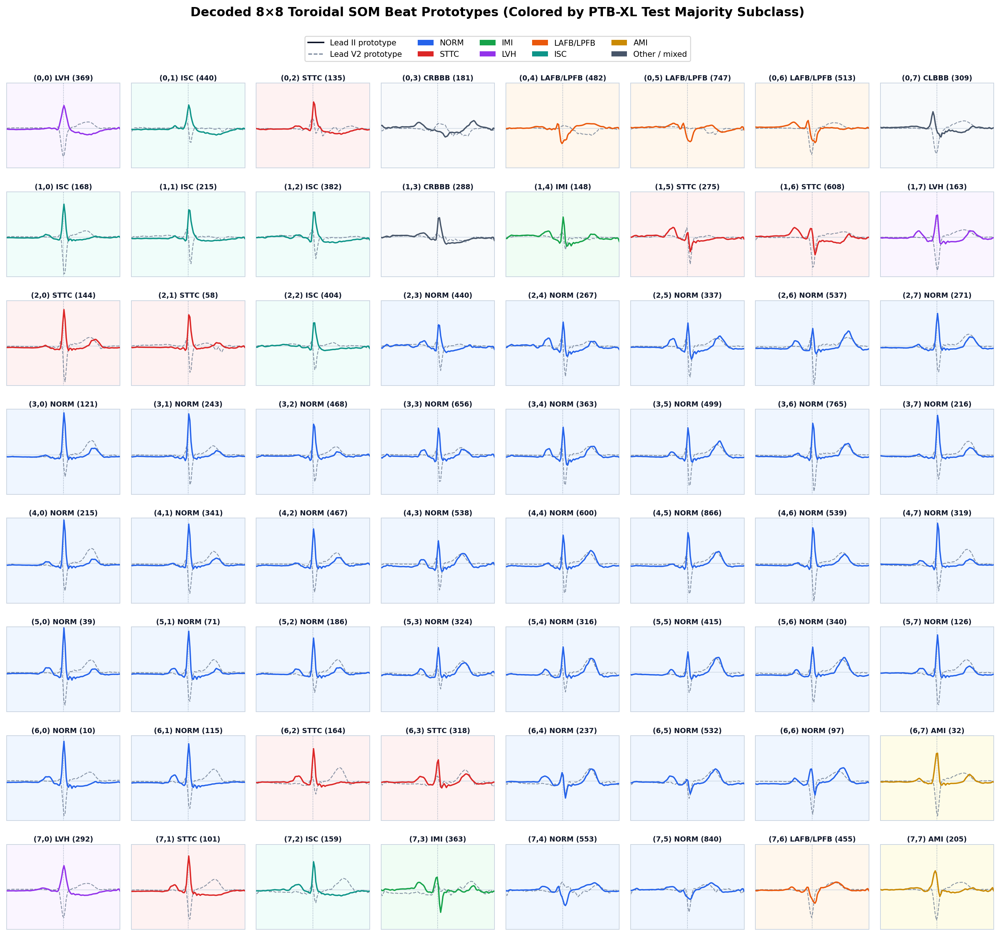

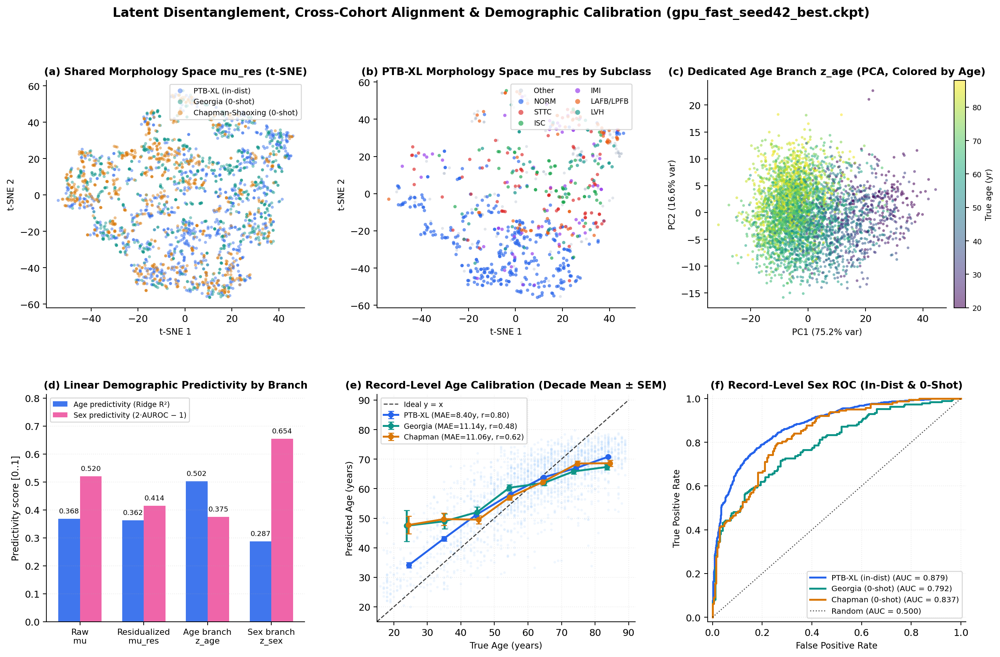

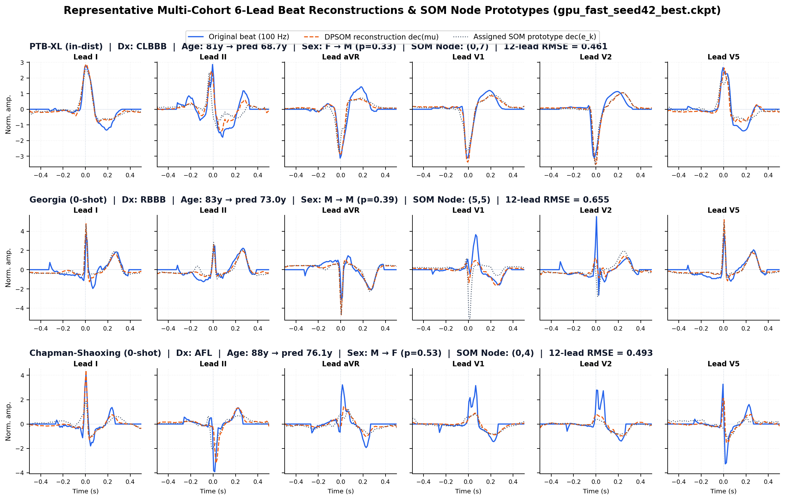

## Requirements

- Python 3.10+
- CUDA-capable GPU recommended for training speed

## Datasets

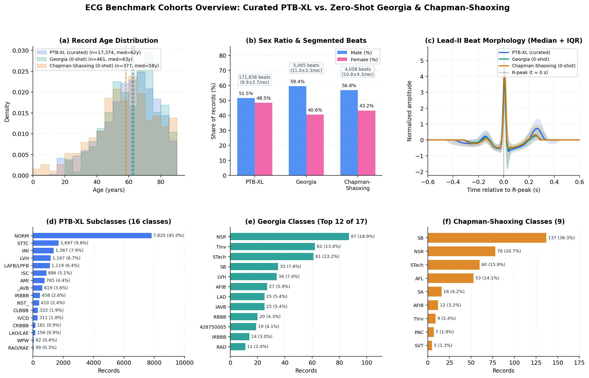

1. **[PTB-XL](https://physionet.org/content/ptb-xl/)**: primary training and evaluation dataset, paired with per-record quality labels (`data/metadata/ptbxl_error_labels.csv`) from [ecg-data-repo](https://github.com/explainable-ecg-learning/ecg-data-repo). Download and unpack PTB-XL to `data/raw/ptbxl/` before running (if `data/processed/ptbxl_100_T-12ms.pkl` is not already present). During training, `train`/`val` apply both `ecg-som`'s noise/beat-segmentation filters and `ecg-data-repo`'s quality curation (`max_error_severity = 2`, excluding `3_severe_error` and `err_scp_zero_diagnostic`).
2. **[Georgia 12-Lead ECG](https://physionet.org/content/challenge-2020/1.0.2/)** (PhysioNet/CinC Challenge 2020, aligned with `ecg-data-repo`): external zero-shot transfer cohort. Download and import into `data/processed/georgia_100.pkl` (also browsable directly in the Explorer dropdown) with `python -m src.data.cinc --dataset georgia --max-records 500 --output data/processed/georgia_100.pkl`.
3. **[Chapman-Shaoxing 12-Lead ECG](https://physionet.org/content/ecg-arrhythmia/1.0.0/)** (PhysioNet `ecg-arrhythmia` 1.0.0, 45,053 ECGs, aligned with `ecg-data-repo`): second external zero-shot transfer cohort using `ConditionNames_SNOMED-CT.csv` + `chapman_shaoxing/quality/error_labels.csv` (`max_error_severity = 2`). Download an evenly stratified subset and import into `data/processed/chapman_shaoxing_100.pkl` (auto-discovered in the Explorer dropdown and passable via `--ext-data` in `ablation/run_paper_experiments.py`) with `python -m src.data.cinc --dataset chapman_shaoxing --max-records 500 --output data/processed/chapman_shaoxing_100.pkl`.

## Repository structure

```text
ecg-som/
├── src/                        # Main project code
│   ├── config.py               # Hyperparameters and configuration
│   ├── inference.py            # New-ECG converter & prediction CLI/API
│   ├── scheduler.py            # Exponential decay LR scheduler
│   ├── model/
│   │   ├── dpsom.py            # DPSOM-ECG model (toroidal SOM, disentanglement, optional age correction)
│   │   ├── baselines.py        # External baselines: ECG_VAE (VAE+K-Means) & ResNet1D_ECG (supervised)
│   │   ├── codec.py            # Lead-wise convolutional encoder / decoder
│   │   └── layers.py           # Shared building blocks (SE block, FiLM)
│   ├── data/
│   │   ├── dataset.py          # PTB-XL dataset loading, quality curation, splits
│   │   ├── cinc.py             # Georgia & Chapman-Shaoxing (PhysioNet CinC) downloader & importer
│   │   ├── generator.py        # GPU-resident vectorized record batch generator
│   │   ├── ptbxl.py            # PTB-XL specific import helpers
│   │   ├── record.py           # Per-record ECG processing and beat segmentation
│   │   └── signal.py           # Low-level signal utilities
│   ├── training/
│   │   ├── trainer.py          # Training CLI, evaluation, best-checkpoint & history logging
│   │   └── baselines.py        # Training & evaluation loops for VAE+K-Means and 1D-ResNet
│   └── utils/
│       ├── make_figures.py     # Generates docs/architecture.png and docs/loss.png
│       ├── make_paper_figures.py# Generates dataset, ablation, SOM, latent & recon figures
│       ├── metrics.py          # Cluster purity, disentanglement & toroidal SOM metrics
│       └── visualization.py    # SOM visualisation helpers
├── docs/                       # Architecture writeup and paper/SOM figures
│   ├── architecture.md
│   ├── architecture.png
│   ├── loss.png
│   ├── datasets_overview.png
│   ├── som_overview.png
│   ├── som_prototypes.png
│   ├── latent_disentanglement.png
│   └── ecg_reconstructions.png
├── explorer/                   # Interactive result explorer (FastAPI + D3)
│   ├── server.py               # Backend entry point (data/-scoped, lazy cells, gzip)
│   ├── export_compact_data.py  # Exports compact per-split .npz files for fast loading
│   ├── explorer.png            # Web Explorer UI screenshot
│   ├── requirements.txt        # Additional explorer dependencies
│   ├── Dockerfile
│   ├── docker-compose.yml
│   └── static/                 # Frontend assets
├── ablation/                   # Ablation study & multi-seed benchmark scripts and results
│   ├── run_paper_experiments.py# Fair matched-k multi-seed baselines, residualization & external eval
│   ├── paper_results_all.csv/json
│   ├── baseline_comparison.png # Matched-k record-level AMI & demographic benchmark chart
│   ├── run_cross_dataset_ablation.py # 3-seed bidirectional cross-dataset & +UDA transfer runner
│   ├── cross_dataset_results.csv/json
│   ├── cross_dataset_transfer.png # Bidirectional transfer matrices & +UDA vs in-domain chart
│   ├── cross_dataset_topology.png # Retention %, SOM topology health, +UDA deltas & scale chart
│   ├── head_ablations.png      # Head & residualization ablation summary figure
│   ├── run_dpsom_sensitivity.py# Single-seed 29-variant parameter sensitivity sweep & plotter
│   ├── dpsom_sensitivity_results.csv/json
│   ├── dpsom_sensitivity.png   # 6-panel parameter sensitivity chart
│   ├── ablation.py             # Legacy 48-variant hyperparameter ablation runner
│   ├── run_ablation_parallel.sh# Parallel 2-GPU ablation launcher
│   ├── merge_ablation_results.py
│   └── ablation_results_all.csv/json
├── tests/
│   └── test_dpsom.py           # Unit & integration regression tests (run via PYTHONPATH=. python tests/test_dpsom.py)
├── data/                       # Organized dataset hierarchy (raw/processed/explorer gitignored)
│   ├── raw/                    # Raw downloaded WFDB corpora (ptbxl/, georgia/, chapman_shaoxing/)
│   ├── processed/              # Preprocessed beat-segmented dataset pickles (.pkl)
│   ├── explorer/               # Compact float16 per-split archives for the web explorer (.npz)
│   └── metadata/               # Versioned quality curation labels (ptbxl_error_labels.csv)
├── logs/                       # Training/evaluation output artifacts (not versioned)
├── models/                     # Saved checkpoints (gitignored except archived legacy 16x16 checkpoint)
├── requirements.txt            # Core Python dependencies
├── LICENSE                     # MIT License
├── .gitignore
├── .dockerignore
└── README.md
```

## License

This project is licensed under the MIT License — see [`LICENSE`](LICENSE) for details.

## Citation

If you use `ecg-som` in your research, please cite this repository:

```bibtex
@software{schlegel2026ecgsom,
  author       = {Schlegel, Udo},
  title        = {ecg-som: Disentangled Representation Learning for ECG Signals with Deep Probabilistic Self-Organizing Maps},
  year         = {2026},
  url          = {https://github.com/explainable-ecg-learning/ecg-som}
}
```

When using the benchmark datasets, please also cite PTB-XL (Wagner et al., *Scientific Data*, 2020), the PhysioNet/CinC Challenge 2020 dataset (Alday et al., *Physiological Measurement*, 2020), and Chapman-Shaoxing (Zheng et al., *Scientific Data*, 2020).

## Contributions

Contributions, bug reports, and pull requests are welcome! Please open an issue to discuss larger changes beforehand, and verify any code changes against the test suite before submitting:

```bash
PYTHONPATH=. python tests/test_dpsom.py
```
