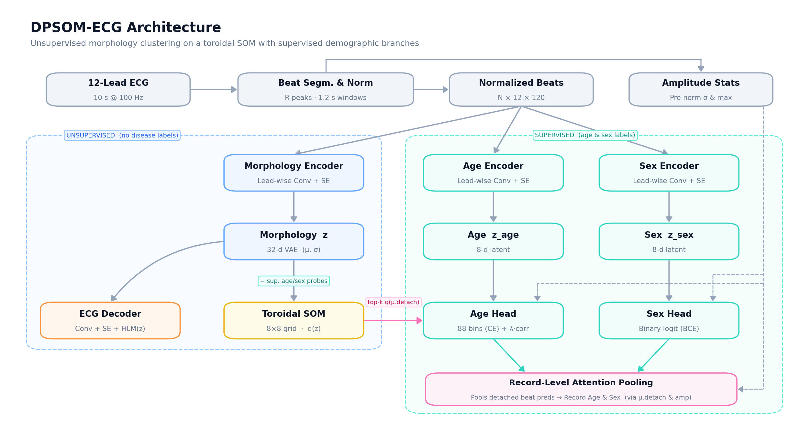
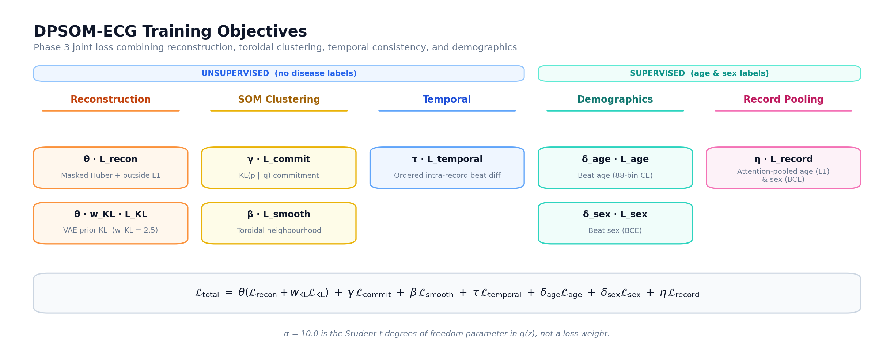

# DPSOM-ECG Architecture



DPSOM-ECG learns a disentangled ECG morphology representation ($z$) that drives clustering on a toroidal Self-Organizing Map (SOM), alongside dedicated demographic branches for age and sex:

- **Three independent lead-wise encoders** map each beat to morphology ($z$), age ($z_{\text{age}}$), and sex ($z_{\text{sex}}$) latents.
- **SOM residualization** computes closed-form cross-covariance directions $\text{cov}(\mu, \text{age})$ and $\text{cov}(\mu, \text{sex})$ after pretraining, orthonormalizes them via Gram–Schmidt in FP32, and projects them out of $z$ before computing SOM distances.
- **Record pooling & optional age correction**: by default (`eta = 0.0`, `age_corr_lambda_max = 0.0`), record-level demographic outputs use a masked mean over valid beats and the age-correction branch is short-circuited; both modules remain toggleable via config/CLI flags.

---

## 1. Data & Preprocessing

PTB-XL 12-lead ECG records (10 s at 100 Hz) undergo merged quality curation ([dataset.py](../src/data/dataset.py), [record.py](../src/data/record.py)):

- **Record-level curation (train/val)**: drops missing `age`/`sex`, `age > 100`, PTB-XL annotated noise (`static_noise`, `burst_noise`, `electrodes_problems`), and severe anomalies from [ecg-data-repo](https://github.com/explainable-ecg-learning/ecg-data-repo)'s `data/metadata/ptbxl_error_labels.csv` (`max_error_severity = 2` drops `3_severe_error`, plus `err_scp_zero_diagnostic`). Test records retain noisy ECGs and enforce `age <= 100` with valid beats.
- **Beat-level preprocessing**: multi-lead NeuroKit2 R-peak detection segments $1.2\text{ s}$ windows ($T = 120$, $C = 12$). Before per-beat, per-lead z-normalization inside the beat mask, pre-normalization amplitude statistics ($\sigma$, $\max |x|$) are saved as `amp_context`.

Each batch from [generator.py](../src/data/generator.py) provides:

| Tensor | Shape | Description |
|---|---|---|
| `beats` | `[B, N, 12, 120]` | Masked, per-lead z-normalized beats (training: `N = 5` randomly sampled, chronologically sorted beats per record, `B = 300`; evaluation: `max_beats = None` uses all valid beats) |
| `beat_mask` | `[B, N, 120]` | Binary mask of valid samples inside each $1.2\text{ s}$ window |
| `beat_meta` (`amp_context`) | `[B, N, 24]` | Pre-normalization per-lead std ($\sigma$) and max-abs amplitude ($\text{amax}$); `26` if `use_rr_features = True` |
| `beat_valid` | `[B, N]` | Binary indicator for non-padded beats |
| `global_beat_idx` | `[B, N]` | Global beat index into target distribution $p$ (`-1` for padding) |
| `record_age`, `record_sex`, `labels` | `[B]` | Age (years), sex (`0 = M`, `1 = F`), and diagnostic subclass (16 classes) |

---

## 2. Model Components

### Encoders & Latent Spaces ([codec.py](../src/model/codec.py), [dpsom.py](../src/model/dpsom.py))

All three encoders (`encoder`, `encoder_age`, `encoder_sex`) share the `LeadWiseConvEncoder` architecture with **independent weights**. Because `groups = 12`, channel counts round down to multiples of 12:

```text
[M, 12, 120]
  → Conv1d(12 → 24, k=7, s=2, pad=3, groups=12) → GroupNorm → SEBlock → LeakyReLU(0.2)   # [M, 24, 60]
  → Conv1d(24 → 60, k=7, s=2, pad=3, groups=12) → GroupNorm → SEBlock → LeakyReLU(0.2)   # [M, 60, 30]
  → Flatten (1800) → Linear(1800 → 512) → LeakyReLU(0.2) → Dropout(0.2)                  # [M, 512]
```

| Branch | Head | Output | Dim |
|---|---|---|---|
| Morphology | `enc_mu`, `enc_logvar` (clamped `[-10, 10]`) | $z = \mu + \epsilon \odot e^{0.5 \log \sigma^2}$ | `32` |
| Age | `enc_age` | $z_{\text{age}}$ | `8` (`0.25 × 32`) |
| Sex | `enc_sex` | $z_{\text{sex}}$ | `8` (`0.25 × 32`) |

### Decoder ([codec.py](../src/model/codec.py))

`LeadWiseConvDecoder` reconstructs the waveform from the **unmodified** morphology latent $z$ (bypassing residualization and the SOM):

```text
z [M, 32] → Linear(32 → 1800) → Dropout(0.2) → LeakyReLU(0.2) → Reshape [M, 60, 30]
  → Upsample(×2) → dwConv1d(60 → 24, k=7) → GN → SE → FiLM(z) → LeakyReLU(0.2)   # [M, 24, 60]
  → Upsample(×2) → dwConv1d(24 → 12, k=7) → GN → SE → FiLM(z) → LeakyReLU(0.2)   # [M, 12, 120]
  → dwConv1d(12 → 12, k=7) → Flatten [M, 1440]
```

### Toroidal SOM & Residualization ([dpsom.py](../src/model/dpsom.py))

- **Codebook**: `_embeddings` of shape `[8, 8, 32]`, initialized from $\mathcal{N}(0, 0.05^2)$ truncated to $[-0.1, 0.1]$, with 4-connected toroidal wrap-around ($\bmod H$, $\bmod W$).
- **Residualization**: frozen normalized cross-covariance directions ($v_{\text{age}} \propto \text{cov}(\mu, \text{age})$, $v_{\text{sex}} \propto \text{cov}(\mu, \text{sex})$) are orthonormalized via Gram–Schmidt ($u_1 = \hat{v}_{\text{age}}$, $u_2 = \text{unit}(v_{\text{sex}} - (v_{\text{sex}}^\top u_1)u_1)$) and projected out in FP32 before computing SOM distances (sampled $z$ during training, deterministic $\mu$ at evaluation and when computing $p$):
  $$z_{\text{res}} = z - (z^\top u_1)\,u_1 - (z^\top u_2)\,u_2$$
- **Soft assignments & target distribution** (Student-$t$ kernel with degrees of freedom $\alpha = 10.0$, deterministic $q_p(\mu)$ for $p$):
  $$q_{ij} = \frac{(1 + \|z_{\text{res},i} - e_j\|^2 / \alpha)^{-(\alpha+1)/2}}{\sum_{j'} (1 + \|z_{\text{res},i} - e_{j'}\|^2 / \alpha)^{-(\alpha+1)/2}}, \qquad p_{ij} = \frac{q_{ij}^2 / \sum_i q_{ij}}{\sum_{j'} q_{ij'}^2 / \sum_i q_{ij'}}$$

### Demographic Heads, Age Correction & Record Pooling ([dpsom.py](../src/model/dpsom.py))

Three separate `Linear(24 → 12) + LayerNorm(12)` projections (`amp_proj_age` and `amp_proj_sex` with `LeakyReLU(0.2)`, `amp_attn_proj` with `Tanh`) map `amp_context` into 12-d features:

| Module | Inputs | Architecture / Output |
|---|---|---|
| **Base Age Head** | `[z_age, amp_proj_age]` (`20-d`) | `Linear(20 → 32) → LeakyReLU → Linear(32 → 88)` (bins 2–89 yr) |
| **Age Correction** (optional) | Top-$k$ ($k=4$) of `q(μ.detach)` → `age_node_emb(64, 24)` + `amp_proj_age` | Weighted `MLP(36 → 64 → 88)` + `amp_shortcut(12 → 88)`, added as $\lambda(\text{ep}) \cdot \text{corr\_logits}$; **short-circuited** when `age_corr_lambda_max = 0.0` (default) |
| **Sex Head** | `[z_sex, amp_proj_sex]` (`20-d`) | `Linear(20 → 8) → LeakyReLU → Linear(8 → 1)` (binary logit) |
| **Record Pooling / Attention** | `[μ.detach, amp_attn_proj]` (`44-d`) | Uses uniform masked mean over valid beats when `eta = 0.0` (default); when `eta > 0`, `Linear(44 → 16) → Tanh → Linear(16 → 1)` + masked softmax pools detached beat predictions |

---

## 3. Training Objectives & Phases



### Phase 3 Joint Loss

$$\mathcal{L}_{\text{total}} = \theta\left(\mathcal{L}_{\text{recon}} + w_{\text{KL}}\,\mathcal{L}_{\text{KL}}\right) + \gamma\,\mathcal{L}_{\text{commit}} + \beta\,\mathcal{L}_{\text{smooth}} + \tau\,\mathcal{L}_{\text{temporal}} + \delta_{\text{age}}\,\mathcal{L}_{\text{age}} + \delta_{\text{sex}}\,\mathcal{L}_{\text{sex}} + \eta\,\mathcal{L}_{\text{record}}$$

| Term | Weight | Definition |
|---|---|---|
| $\mathcal{L}_{\text{recon}}$ | $\theta = 0.1$ | Cosine-tapered masked Huber ($\delta = 0.5$, edge $0.1$, scaled by $CT$) + L1 outside `beat_mask` |
| $\mathcal{L}_{\text{KL}}$ | $\theta \cdot w_{\text{KL}}$ ($w_{\text{KL}} = 2.5$) | Diagonal Gaussian $\text{KL}(q(z|x) \parallel \mathcal{N}(0, \sigma_0^2 I))$ |
| $\mathcal{L}_{\text{commit}}$ | $\gamma = 10.0$ | $\text{KL}(p \parallel q(z))$ against epoch-refreshed target distribution $p$ |
| $\mathcal{L}_{\text{smooth}}$ | $\beta = 0.5$ | Toroidal 4-neighbour soft-assignment cross-entropy |
| $\mathcal{L}_{\text{temporal}}$ | $\tau = 1.6$ | Mean $\|z_{t+1} - z_t\|^2$ across chronologically ordered valid beats in a record |
| $\mathcal{L}_{\text{age}}, \mathcal{L}_{\text{sex}}$ | $\delta_{\text{age}} = 1.0, \delta_{\text{sex}} = 1.0$ | Beat-level 88-bin cross-entropy (age) and BCE (sex) |
| $\mathcal{L}_{\text{record}}$ | $\eta = 0.0$ (optional) | $0.4\,\delta_{\text{age}}\,\text{L1} + \delta_{\text{sex}}\,\text{BCE}$ on attention-pooled detached beat predictions |

### Training Schedule ([trainer.py](../src/training/trainer.py))

| Phase | Epochs | Optimiser & LR | Objective |
|---|---|---|---|
| **1. Pretraining** | `10` | Adam (`7e-4`) | $\theta(\mathcal{L}_{\text{recon}} + w_{\text{KL}}\mathcal{L}_{\text{KL}}) + \delta_{\text{age}}\mathcal{L}_{\text{age}} + \delta_{\text{sex}}\mathcal{L}_{\text{sex}}$ |
| **1.5 / 1.6 Probes** | closed-form | Exact cross-covariance (model frozen) | Compute normalized $\text{cov}(\mu, \text{age})$ & $\text{cov}(\mu, \text{sex})$ on train $\mu$ (skipped cleanly if `num_epochs_probe = 0`) |
| **2. SOM Init** | `4 × 2 = 8` | Adam (`0.9 → 0.3 → 0.1 → 0.01`) | `loss_som_s + loss_commit_s` on detached residualized $z$ |
| **3. Joint Training** | `24` | Adam (`7e-4`, meta `lr/5`, staircase `0.99/1000`, clip `5.0`) | Full $\mathcal{L}_{\text{total}}$ with deterministic $p(\mu)$ refreshed each epoch, optional periodic closed-form refit (`probe_refit_interval = 0` default; set `6` for stronger invariance), and best val-NMI checkpoint saved (`*_best.ckpt`) with full architecture/module metadata |

---

## 4. Default Configuration ([config.py](../src/config.py))

| Group | Parameters & Defaults |
|---|---|
| **Latent & SOM** | `latent_dim = 32`, `z_age_dim_factor = 0.25`, `z_sex_dim_factor = 0.25`, `som_dim = (8, 8)`, `som_init_std = 0.05` |
| **Encoder** | `encoder_base_channels_1 = 32` (`→24`), `encoder_base_channels_2 = 64` (`→60`), `encoder_kernel_size = 7`, `encoder_fc_hidden_dim = 512`, `dropout = 0.2` |
| **Optional Modules** | `age_corr_lambda_max = 0.0`, `eta = 0.0`, `probe_refit_interval = 0`, `use_rr_features = False` (pruned after 3-seed ablation; all remain toggleable) |
| **Loss & SOM** | `alpha = 10.0`, `beta = 0.5`, `gamma = 10.0`, `theta = 0.1`, `prior = 2.5`, `prior_var = 1`, `tau = 1.6`, `delta_age = 1.0`, `delta_sex = 1.0` |
| **Training** | `batch_size = 300`, `num_beats = 5`, `learning_rate = 7e-4`, `lr_meta_factor = 5.0`, `weight_decay = 0.0`, `gradient_clip_norm = 5.0`, `decay_factor = 0.99`, `decay_steps = 1000` |
